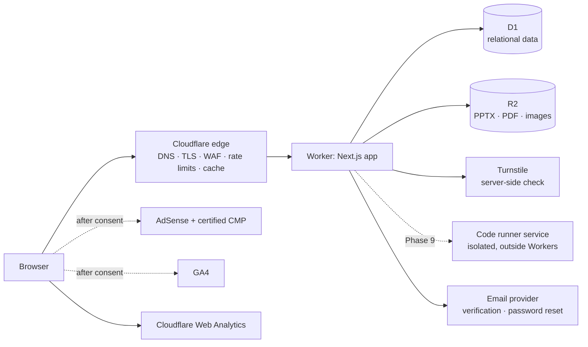

# Code_Expert architecture

The site's visitor-facing name is **Code_Expert** (owner's choice, 2026-10-08; it was "CodeLab" during Phase 1). Internal names stay `codelab`: the npm package, the Worker, the D1 database `codelab` and the R2 bucket `codelab-files`, so nothing in Cloudflare needs renaming. The name lives in one constant, `src/lib/site.ts`.

Status: **Phase 2 done locally, waiting for review.** Phase 1 (foundation) was reviewed before it. This document covers planning items A–G from the build brief (`docs/brief/MASTER_BUILD_PROMPT.md`). The app scaffold, Drizzle schema, Workers config, local D1, tests and base layout are built and tested (see `TESTING_REPORT.md`). Nothing is deployed to Cloudflare yet; that needs the owner's account.

Facts checked against official docs on 2026-10-08 are marked ✔ with a source at the end. Anything still to be confirmed is marked **[verify]**.

---

## Core rule: courses are independent learning environments

Code_Expert is one platform that hosts several **completely separate courses**:

1. Programming Fundamentals (C++)
2. Programming Applications (Python)
3. Computer Vision (Python and OpenCV)

More courses can be added later as data, without code changes.

**Nothing crosses a course boundary:** lectures, materials, questions, quizzes, exams, progress, scores, search results, achievements and admin content management.

The rule is enforced in three layers:

1. **Database.** Composite foreign keys `(course_id, …)` make cross-course links impossible to store. Details and tests are in `DATABASE.md`.
2. **Server code.**
   - Every data-access function for course content takes a `CourseScope`, which is resolved once per request from the URL's course slug, and every query filters by its `course_id`.
   - A lint rule and code review checklist forbid querying course tables without it.
   - Admin mutations check that the target row's `course_id` matches the course in the URL *and* that the user may manage that course.
3. **URLs and navigation.**
   - Students pick a course first. Everything after that lives under `/courses/<course>/…`.
   - The course header shows which course you are in and offers a course switcher, never a mixed list.

---

## A. Architecture overview

### Runtime: Next.js on Cloudflare Workers

- **What Cloudflare recommends now** ✔: **vinext** is Cloudflare's default for new Next.js apps on Workers, and Wrangler's automatic setup uses it.
  - It is **in beta**. Cloudflare advises running `npx vinext check` and reviewing its compatibility dashboard before production use.
  - **OpenNext** (`@opennextjs/cloudflare`) remains documented for existing apps. On OpenNext, Node.js middleware (Next.js 15.2+) is not supported.
- **Decision (confirmed in Phase 1):**
  - The app is standard Next.js App Router code running on **vinext 1.0.1**, scaffolded with Cloudflare's `create-vinext-app`. `npx vinext check` reports 100% compatible (10 supported, 0 partial, 0 issues), so OpenNext isn't needed.
  - vinext's own README (in the npm package, 2026-10-08) still says it is "under active development" with known gaps in Cache Components / Partial Prerendering and build-time image and font optimization. Code_Expert avoids those features: fonts are self-hosted CSS, not `next/font`.
  - **Wrangler, not `cf`.** New vinext projects default to Cloudflare's new `cf` CLI with `cloudflare.config.ts`, but `cf` is still a beta (1.0.0-beta.13). The project uses the `--legacy-wrangler-cloudflare-init` option instead: stable Wrangler 4.149 and `wrangler.jsonc`, as planned.
  - Bindings are read with `import { env } from "cloudflare:workers"`, the method vinext recommends, and **only** in `src/server/platform/env.ts`. A lint rule enforces this, so switching adapters changes that module and the build scripts only.
  - Avoid Node.js-runtime middleware so both adapters stay possible.
  - Note: `developers.cloudflare.com` was blocked by this build environment's network policy on 2026-10-08, so the facts above come from the vinext and Wrangler packages themselves (README, config schema, CLI help), which Cloudflare publishes.
- **Language and UI:** TypeScript (strict), Tailwind CSS, accessible headless components (shadcn/ui-style, owned in the repo), Lucide icons.
- **Data access:** Drizzle ORM over D1 (`src/db/`). The SQL files in `migrations/` stay the source of truth and are applied with Wrangler. The Drizzle schema mirrors them for typed queries.
  - `drizzle-kit check` can't compare against hand-written SQL, so instead `tests/integration/drizzle-mirror.test.ts` renders the Drizzle schema to SQL, applies both to local D1, and compares every table's columns, keys and indexes.
  - CHECK constraints, triggers, the FTS5 search table and `COLLATE NOCASE` live only in SQL; enum CHECKs are mirrored as TypeScript types in `src/db/enums.ts`.
  - New migrations are written by hand (never generated by drizzle-kit), and the mirror test must stay green.

### Server layers

| Layer | Folder | Responsibility |
|---|---|---|
| Routes | `src/app/**` | Server components render public content; client components only where interaction is needed (question widgets, editor, uploads). |
| Domain services | `src/server/<domain>/` | courses, content, resources, exercises, grading, quizzes, exams, progress, auth, ads, seo. Every course service takes a `CourseScope`. |
| Data | `src/db/` | Drizzle schema, query helpers, data shapes for public and admin views. Answer keys are only read inside `grading` and `admin`. |
| Pure logic | `src/lib/` | Grading and normalization, scoring, slugs, markdown rendering, validation schemas. No I/O, fully unit-tested. |
| Platform | `src/server/platform/` | Bindings, Turnstile verification, R2 helpers, rate limiting, request ids, error logging. |

### Rendering and caching

- **Public pages** (course, lecture, resource description, exercise prompt) are server-rendered and must work without JavaScript for reading. In Phase 2 they render on every request (`dynamic = "force-dynamic"`, data read from D1 per request, deduplicated within a request by React `cache()`).
- **Edge caching is a deployment decision, not built yet.** vinext 1.0.1's README offers a KV data-cache adapter (needs a KV namespace binding) and a Workers Cache CDN adapter with `revalidateTag()`/`revalidatePath()` purging. Either would cut CPU per visit (a lecture page costs about 60 ms of CPU on this machine, see the testing report). Choosing and testing one needs the real Cloudflare account, so it moves to the first deployment. **[verify]** against Cloudflare's docs then.
- **Signed-in data** (progress marks, bookmarks, drafts) loads separately with `Cache-Control: private, no-store`. Shared caches never hold user data.
- **Downloads** are served through a Worker route that checks the resource's `access` level, then streams from R2 with correct `Content-Type`, `Content-Disposition` and cache headers.

### Assessment integrity

- **MCQ and trace:** graded on the server. Normalization rules (trim, collapse whitespace, case) come from the question's `settings` so outputs with meaningful whitespace are compared exactly.
- **Correct-the-code:** compared against *several* accepted solutions after normalization. With a code runner configured (Phase 9), graded by test cases instead. Grading never relies on one exact string.
- **Write-the-code (owner decision 2026-10-09: "Run in browser"):** the student's program runs against the question's visible test cases in their own browser (Pyodide, or Clang compiled to WebAssembly), then the model solution and explanation are shown. Browser results are practice feedback only and never count as marks, so write-the-code is not allowed in quizzes or exams (the content build refuses it) until the Phase 9 runner. Hidden test cases never leave the server.
- **Exam-mode quizzes:** answer keys and explanations are withheld until submission (database `CHECK` forces delayed feedback for exam mode). Timers are enforced server-side with `deadline_at`.
- **Attempts (Phase 3, stored from Phase 5):** in Phase 3 attempts were not stored in D1. Starting a quiz or exam returns an HMAC-signed token (secret `ASSESSMENT_SECRET`) holding the course, the quiz or exam, the questions in order, their points and the deadline. Submit checks the signature, the course and the deadline (60 s grace) before marking, so the browser can't swap questions or extend time. Answers are autosaved in the browser only. Since Phase 5, a signed-in student's attempts are also written to `quiz_attempts` / `exam_attempts` / `custom_exam_attempts` (migration 0005) at start, with the row id derived from the token's nonce, and every answer is kept at submit; the signed token stays the source of truth for marking, so guests work exactly as before.
- **Correct-the-code marking (Phase 3):** the fix matches the reference or any "also accepted" fix token for token, ignoring layout, comments and quote style (Python indentation levels still count). In practice mode, passing every visible test in the browser also counts as fixed; in quizzes and exams only the server's match counts. The content checker proves every accepted fix passes all tests and the broken code fails one.
- **Attempt limit (Phase 5):** a quiz with `max_attempts` (the final C++ quiz: 2) needs a student account. Each start is a conditional insert into `quiz_attempts` that only succeeds while the student has fewer than `max_attempts` starts of the quiz or any of its models in the last 24 hours, so two tabs can't both get a third try; otherwise 429 with the unlock time. Guests get 401 with `signInRequired` and the quiz page offers sign in or sign up. (Phase 3 kept this count in a per-browser cookie.)
- **Reserved questions and quiz models (Phase 3 follow-up):** questions with `settings.reserved` belong to one quiz (or its models) and are filtered out of every public listing, page, search row, practice set, custom exam and practice-exam bank (`notReserved()` in `src/server/exercises/catalog.ts`). A quiz's other versions are quiz rows with the slug `<quiz>-model-<letter>`; they are never listed or served on their own, start picks one at random (never the last one: the student's last attempt when signed in, an HttpOnly cookie for guests), and the attempt token names the model it drew. No migration was needed.
- **Custom exams (Phase 3 follow-up):** "Build your own exam" draws up to 30 non-reserved questions spread evenly over the topics the student picks. Its settings (title, timer, feedback, pass mark) travel inside the signed token, since nothing is stored.
- **Code runner (Phase 9):**
  - A `CodeRunner` interface with a `NullRunner` default.
  - A real runner must be a separate isolated service: disposable sandboxes, no network, CPU/memory/time/output limits, no host files or secrets, concurrency limits.
  - Untrusted code never runs inside Workers or the main app.

### Lessons taught on the site (owner requirement, built in Phase 2)

The owner wants every lecture **taught in full on the site, like Codecademy and similar teaching sites**, not only as a PowerPoint. The slides become a supplement attached to the lesson, never the lesson itself.

- **Lesson page:** objectives and prerequisites, then the lesson body as ordered `lesson_sections` (explanation, worked example, code, diagram, common mistakes, note, key takeaways), with short "check yourself" questions between sections (predict-the-output, MCQ, trace, linked through `exercises.lesson_id`), the slides/PDF as a download, related lectures and previous/next. Progress and bookmarks when signed in (Phase 5).
- **Built in Phase 2.** Lessons are written as Markdown files in `content/<course>/lessons/` (format: `docs/CONTENT.md`), checked by running every program, and loaded into D1 by `npm run content:build`. Migration `0002_lesson_sections_interactive.sql` adds the per-section fields the stage needs: `runnable`, `sample_input`, `expected_output`, `annotations` (JSON notes and strips) and the section image (`image_key`, size, alt text). Migration `0003_cpp_runnable.sql` lets C++ sections be runnable too.
- **Home page code box:** the same stage with **Python | C++ tabs** on top of the INPUT box (`src/components/home/code-playground.tsx`). Each language keeps its own edits while you switch.
- **The lec stage** (owner's "Omar Ahmed lec style", 2026-10-08) shows each lesson program the way the lecture videos do: an INPUT box where the code types itself, note chips joined by thin lines to the exact code they explain, index strips under Strings and Lists, the yellow round Run button, and an OUTPUT box. Everything is server-rendered; JavaScript adds the typing, Run, Edit and Copy. Reduced motion shows the code at once.
- **Running code (owner approved, 2026-10-08):**
  - **Python** sections marked `run` really run, on the **student's device**: Pyodide 314.0.7 (Python 3.14) in a module Web Worker (`public/runner/python-worker.mjs`). Nothing runs in Workers or the main app. Stop and the 10-second limit terminate the worker. Each run gets fresh variables; keyboard input comes from the "Typed by the user" box, one line per `input()`, echoed into the output like a terminal. Students can edit the code and run their version. Only the standard library is allowed in runnable programs (the checker enforces this).
  - Pyodide is **self-hosted** from this site's static assets (`/pyodide/314.0.7/`, copied from the npm package by `tools/copy-pyodide.mjs` at build time). No CDN. The first Run downloads about 13.5 MB uncompressed (about 6.3 MB if gzip-compressed in transit); later runs use the browser cache (`Cache-Control: immutable`, set in `public/_headers`).
  - **C++** sections marked `run` (owner request 2026-10-09: "an option to write C++ in there too") are **compiled and run on the student's device** as well:
    - The compiler is the npm package `browsercc` 0.1.1: Clang 20.1.2, wasm-ld and libc++ compiled to WebAssembly, building WASI programs. It is self-hosted like Pyodide: `tools/copy-cpp-runtime.mjs` prepares `/cpp/browsercc-0.1.1/` at build time (the big files gzip-compressed, the largest 15 MB, so every file is far under the static-asset size cap; the worker unpacks them with `DecompressionStream`). The downloaded files carry a content stamp in their names and are cached for good; `files.json`, which names them, is revalidated on every load, so a changed compiler file reaches browsers that cached the old one. No CDN, no service.
    - `public/runner/cpp-worker.mjs` compiles with `-std=c++17 -O0 -fno-exceptions` and an 8 MiB stack, then hands the program to a fresh `public/runner/cpp-program-worker.mjs`, which runs it with a small WASI layer: output appears while the program runs, each line of keyboard input is handed over and echoed when `cin` reads it, and crashes (division by zero, out-of-range memory) are reported in plain words. Stop and the 10-second limit end only the program worker, so the compiler stays loaded (Stop during the first download or a compile also leaves the compiler worker running, so the next Run doesn't start over); compiling has its own 60-second limit. Before echoing a line of keyboard input, the program worker flushes stdout (the program exports `fflush`), so a `printf` prompt shows before what was typed, as in a terminal.
    - Compile errors show clang's messages with `main.cpp` line numbers; the editor has line numbers too.
    - Chosen on 2026-10-09 after testing four npm runtimes on every C++ program in the lectures: `browsercc`, `@live-codes/clang-wasm` and `@yowasp/clang` all matched g++ on 63/63 programs; the JavaScript interpreter JSCPP matched 54/63 and lacks `std::string`, `vector` and classes. browsercc used the least memory and compiled fastest. Downloads: about 30 MB the first time (then cached); compiling takes about 1.5 to 3 seconds on a desktop.
    - Known limits: no C++ exceptions or threads, `long` is 32-bit (as on Windows compilers), `system()` doesn't exist, recursion depth is limited to a few thousand calls, programs can't open files.
    - **[verify]** on real phones and on Safari and Firefox: only desktop Chromium was tested. The compiler needs about 400 MB of memory while loaded, which may be too much for phones with 2 GB of RAM.
  - **OpenCV** programs don't run in the browser. Their OUTPUT box shows the **recorded output**: the build tool ran the program with Python + OpenCV and the box shows exactly what it printed. The button says "Show output" and the status line says it is recorded, so nothing pretends to execute.
  - **OpenCV in the browser stays off.** It isn't in the npm package's core files; getting its wheel means downloading from a host the owner hasn't approved. Revisit with the owner if wanted.
  - Results from the browser are never trusted for grading or progress.
  - **[verify]** with Pyodide's docs (pyodide.org, approved by the owner but blocked by this session's network policy): memory and speed on low-end phones, and whether the files need any server headers beyond the ones set. Tested here in desktop Chromium only.
- **OUTPUT boxes are terminal transcripts.** What the user typed appears where the program read it (green and underlined), and everything else is what the program printed. The checker removes the typed lines and compares the rest with the real output, and fails if a typed line is missing (`src/lib/lesson/transcript.ts`).

## E. Page and component inventory

Course separation changes some routes from the original brief: lists that would mix courses become **"choose a course" entry points**.

### Public pages

| Route | Purpose | Index? |
|---|---|---|
| `/` | Home: what Code_Expert is, a runnable demo, the three courses | yes |
| `/courses` | Course directory (cards, category filter) | yes |
| `/courses/[course]` | Course home: intro, ordered lectures by topic, what you'll practise, sign-in progress | yes |
| `/courses/[course]/topics/[topic]` | Topic overview and its lectures/exercises | yes |
| `/courses/[course]/lectures/[lecture]` | Written lecture: objectives, sections, code, mistakes, takeaways, resources, related, next/prev | yes (published only) |
| `/courses/[course]/resources` · `/[resource]` | Presentations and PDFs with original context, preview, download | yes (substantial pages) |
| `/courses/[course]/exercises` | Question library with filters (type, difficulty, topic) | yes |
| `/courses/[course]/exercises/[exercise]` | One question (MCQ / trace / correct / write) | yes if it has a real explanation; otherwise noindex |
| `/courses/[course]/practice` | Random sets, retry mistakes, recommended next | noindex |
| `/courses/[course]/challenges` · `/[challenge]` | Harder write-the-code problems | yes |
| `/courses/[course]/quizzes` · `/[quiz]` | Quiz directory and quiz runner | directory yes, runner noindex |
| `/courses/[course]/exams` · `/[exam]` | Practice exams (timer, navigator, autosave, review) | directory yes, runner noindex |
| `/courses/[course]/search` | Search within the course | noindex |
| `/exercises` `/quizzes` `/exams` `/practice` `/challenges` `/resources` `/search` | "Choose a course" entry points | noindex, follow |
| `/about` `/contact` `/privacy-policy` `/terms` `/cookie-policy` `/advertising` `/accessibility` | Information and legal (Phase 6: drafts with marked gaps for the owner's details, no invented identity) | yes |
| `/privacy-choices` | Change ad consent; clear this site's data on this device (Phase 6) | noindex |
| `/login` `/register` `/forgot-password` | Accounts (Phase 5). No `/reset-password` or `/verify-email` until there is an email provider: recovery codes instead | noindex, disallowed in robots.txt |
| `/dashboard` | Pick a course; one summary card per course, never combined scores | noindex |
| `/dashboard/[course]` · `/progress` · `/bookmarks` · `/history` · `/history/[attempt]` | Per-course dashboard; one submitted attempt's review | noindex |
| `/settings` | Account, data export, deletion, sessions | noindex |
| `/account-deleted` | Shown after a student deletes their account | noindex |
| `/robots.txt` `/sitemap.xml` `/ads.txt` | Generated | n/a |
| 404 / error pages | Helpful, link back to courses | noindex |

### Admin pages

Built in Phase 4. Every admin page, route handler and server action checks the signed-in staff member and their permission on the server (`requireStaff` / `requireSite` / `requireCourse` for pages, `courseActor` / `staffActor` for actions), and the services check again with `can()`. `tests/unit/admin-guards.test.ts` fails if a new admin file skips the check. All admin pages are noindex. Times are shown in Cairo time.

- `/login`: sign-in for everyone (moved to `src/app/(auth)/` in Phase 5). Staff accounts are never made by signing up. Rate limits per account and per address (D1 `rate_limits`, migration 0004); Turnstile when its keys are set.
- `/admin`: the courses this person can open, with counts, a production setup checklist (Turnstile, `ASSESSMENT_SECRET`) and recent activity.
- `/admin/courses` (administrators): every course, reorder; `/admin/courses/new`.
- `/admin/courses/[course]`: overview (counts, what is scheduled, draft lectures, recent activity), then one tab per area:
  - `/topics`: add, edit, reorder, publish, delete.
  - `/lectures`, `/lectures/new`, `/lectures/[id]`: the lecture editor (details, sections with Markdown, pictures, programs with input/output, notes and strips, related lectures and files, publish now or at a set Cairo time, search-engine title and description), `/preview`, `/history` (restore any saved version), `/export` (the lecture as a content Markdown file).
  - `/questions`: filters (text, type, topic, status, level), New by kind (all 8 formats), Import (the JSON from Export, or content Markdown files; each is checked and saved, existing addresses are updated), Export all (JSON); `/questions/[id]`: Form and Markdown tabs with the content-file check running as you type, `/preview` with the answer key, `/history`, `/export`, duplicate, delete.
  - `/quizzes`: quizzes with their models; the editor picks questions, points and order, sets the timer, pass mark, attempts per 24 hours, shuffling and status; "Add a model" copies the questions to a new version, and the page shows how many questions every model shares.
  - `/exams`: practice exams as draw rules, with a live count of matching published questions per rule; publishing is refused when the rules can't always be filled.
  - `/files`: details, upload or replace the original and a preview PDF, staff download, delete. The type is checked from the file's bytes, never from its name.
  - `/settings` (course admins and administrators): title, description, language, tags, search-engine settings; publish, draft or archive (administrators); rename the address (administrators); delete an archived course after typing its slug (administrators).
  - `/activity`: the course's audit entries.
- `/admin/users` and `/admin/users/[id]` (administrators): add staff with a one-time temporary password, change role and per-course roles, reset the password, sign out everywhere, disable or enable. The last administrator can't be demoted or disabled.
- `/admin/account`: change password (signs out other devices), signed-in devices, the role summary. A banner on every admin page asks someone on a temporary password to change it.
- `/admin/audit-log` (administrators): every sign-in and change, with addresses.
- `/admin/students` (administrators, Phase 5): find a student by name or email, give a temporary password (for a student who lost both password and recovery code), disable or enable, delete with everything saved for the account (after typing their email). Every action is in the audit log.
- `/admin/courses/[course]/students` (anyone who can open the course, Phase 5): that course's numbers only, never names: students who used it, active in 7 and 30 days, came back on another day, answers and how many were right, the last 8 weeks, by topic, the hardest questions (at least 5 answers), quiz results (models counted with their quiz) and how many opened and finished each lecture. Staff accounts and guests are not counted.

- `/admin/ads` (administrators, Phase 6): the live-ads checklist, ad settings (switch, publisher id, staff hidden, most ads per page), consent platform, placements by template, exclusions, the never-list, preview links, content per course and the last 20 changes. `/admin/ads/placements/new` and `/[id]`: one placement (position, digits-only ad unit id, format, devices, reserved height, on/off). No revenue figures and no field for scripts or HTML.
- `/admin/site` (administrators, Phase 6): the owner's details used by the legal pages, the "reviewed" tick, the Search Console token and the AdSense site-ownership tag.
- `/admin/messages` (administrators, Phase 6): the contact form inbox (read, archive, delete).

Not built yet, from the brief's list: content analytics (popular lectures, search terms; would need page-view logging), an error inbox (Phase 7).

#### How saving works

- Each save is one D1 batch: the content rows, the search index, a revision snapshot (`content_revisions`) and an audit entry, so a failed save changes nothing.
- Editors save; a save by an editor keeps the current status. Course admins and administrators publish, schedule, archive and delete.
- Questions are checked with the same rules as the content files (they are written to Markdown and parsed back), so a question made in the admin can be exported to `content/` unchanged. Option and child ids are derived from the course, the question's address and the position, as in `tools/build-content.ts`, so answers already sent keep pointing at the right option.
- A question can't be unpublished or deleted if that would leave a published practice exam unable to draw, and a published quiz can't contain draft questions (its models included).
- Uploads are streamed to R2 (never held whole in memory) with a SHA-256 computed on the way; Office files are checked by reading the zip's file list, and macro-enabled files and SVG are refused. Replacing a file deletes the old object after the database points at the new one.

### Components

- **Layout:** `SiteHeader`, `CourseSwitcher`, `CourseNav`, `Breadcrumbs`, `SkipLink`, `ThemeToggle`, `Footer`.
- **Content:** `LectureBody` (rendered Markdown), `CodeBlock` (highlighting + copy), `TableOfContents` (sticky on desktop), `ObjectivesList`, `CommonMistakes`, `KeyTakeaways`, `ResourceCard`, `PdfPreview`, `DownloadButton`, `RelatedLectures`, `LectureNav`.
- **Practice:**
  - Question shells: `QuestionShell`, `McqQuestion`, `TraceQuestion`, `CorrectCodeQuestion`, `WriteCodeQuestion`.
  - Tools: `CodeEditor` (Monaco, loaded lazily), `HintReveal`, `ExplanationPanel`, `TraceTable`.
  - Assessments: `Timer`, `QuestionNavigator`, `ResultSummary`, `DifficultyBadge`.
- **Dashboard:** `CourseProgressCard`, `ProgressRing`, `HistoryTable`, `RecommendedNext`.
- **Admin:** `DataTable`, form fields with validation messages, `MarkdownEditor`, `FileUploader` (progress, type/size checks), `PublishControls` (draft, schedule, publish), `QuestionEditor` per type, `AuditLogTable`.
- **Ads and consent (Phase 6):** `AdSlot` (nothing, a hidden marker, or a live unit), `AdUnit` (label, reserved space, unfilled folding, error boundary), `AdPreview` (staff preview box), `ad-loader.ts` (the AdSense and CMP scripts, the TCF wait); legal parts (`DraftNotice`, `Fact`, `LegalTable`).
- **States:** skeletons, empty states, error states, search-empty state.

### Design system

- **Look (changed 2026-10-08):** the owner's **"Omar Ahmed lec style"**, the style of their lecture videos. It replaces the brief's navy, electric blue and purple look. Dark navy "cinema" panels (radial navy, faint grid floor) for page headers and lesson code; the light theme keeps light pages around them.
- **Palette:** ink `#F2F5FA`, yellow `#FFD43B`, sky `#8CC4F2`, coral `#FF8A7A`, green `#5FD39A`, Python blue `#3776AB`, navy `#14213D`. Where a lec colour is too light for text on a light page (yellow, sky), the light theme uses a darker text shade (`#2a5a87` for links) so every pair passes WCAG 2.2 AA; yellow stays as a fill (buttons, Run) with navy text on it.
- **Typography:** Poppins (titles and text) and DejaVu Sans Mono (code), self-hosted from npm (`@fontsource/poppins`, `@fontsource/dejavu-mono`, Latin subsets), no third-party font requests.
- **Tokens:** `src/styles/tokens.css` defines every colour once per theme as `--cl-*` variables, and Tailwind utilities read them. The fixed stage colours are `--lec-*` in `src/styles/lec.css`. The contrast tests (`tests/unit/design-tokens.test.ts`) check the pairs in both themes.
- **Lesson stage pieces:** chapter labels (`01 ── Topic`), note chips with circle / square / diamond / triangle markers, strips with index and negative index pills, a yellow `*word*` in titles.
- **Theme:** follows the operating system until the visitor picks Light or Dark with the header toggle. The choice is stored in the browser and applied by a tiny inline script before first paint. Phase 7's Content-Security-Policy must allow that script by hash.
- **Base layout:** sticky header (logo: navy square with the yellow run button; course switcher; "All courses"; theme toggle), skip link, footer with course links and About, Accessibility and Search, custom 404 and error pages, empty states. Contact, privacy, terms, cookies and disclaimer need facts only the owner has, so they aren't linked until written.
- **Accessibility:** visible focus rings, 44 px touch targets, AA contrast in both themes, text descriptions for lesson pictures, output announced to screen readers, keyboard-only Run (Ctrl+Enter from the editor).
- **Motion:** code typing, the Run pulse, the flying output line and the error shake. All of it is skipped with reduced motion.
- **Phone layouts:** checked from 320 px wide to desktop in both themes.

---

## F. Advertising policy-readiness architecture (built in Phase 6)

The goal is long-term AdSense revenue without risking the account or student trust. Details, positions and tests: `docs/PHASE_6_AD_PLACEMENT_PLAN.md`; consent: `docs/PHASE_6_PRIVACY_AND_CONSENT.md`; Google's rules and their status: `docs/PHASE_6_ADSENSE_COMPLIANCE_AUDIT.md`.

### Off by default

A live ad needs **all** of: `APP_ENV=production`; `ADS_ENABLED="true"` (deployment setting, owner only); the admin switch on; a valid publisher id (`pub-` + 16 digits, entered from the real account, never generated); a consent platform (Google's Privacy & messaging, or a certified CMP whose script is the `CMP_SCRIPT_URL` deployment variable); and for each position an enabled placement with a digits-only ad unit id (the database refuses `enabled = 1` without one), on a page that isn't excluded and within the page's cap. Local and preview builds never load the AdSense script.

### Where the rules live

- `src/lib/ads/policy.ts`: pure, unit-tested rules: the fixed positions per template (home, course, lecture, single question, file page), hard caps per page (2, 1, 3, 1, 1; the admin can only lower them), the never-list of paths, id validation, path patterns (no regular expression built from input), the readiness checklist, the per-page decision and the safe in-text breaks in lectures (only between sections that end and start with text, never next to a code box, Run button, output or picture).
- `src/server/ads/settings.ts`: reads settings (`site_settings` key `ads`), consent (`consent_configuration`), placements and exclusions; `pageAds()` gives each page its slots and falls back to "off" on any error.
- `src/server/admin/ads.ts`: validated, audited writes (administrators only).

### Never shown on

Fixed in code (`NEVER_AD_PATHS`), whatever the settings: admin, API, sign-in, sign-up, recovery, dashboard, settings, account pages, quiz and exam runners, custom exams, practice sets, search, contact, legal pages and privacy choices. Pages that never render a slot: course lists, topic pages, the question library, quiz and exam lists, error and not-found pages, demo questions, file pages without a real description, courses without lectures.

### What a slot renders

- Not allowed or over the cap: nothing.
- Allowed but not live (the normal state today): an empty hidden marker with no size. `?ad-preview=1` turns it into a labelled box (in production only for signed-in staff); no ad is requested.
- Live: an `<aside aria-label="Advertisement">` with the visible label, reserved `min-height`, Google's `<ins class="adsbygoogle">` pushed once, removed if Google reports `unfilled`. Signed-in staff get no live ads by default.

### Consent

Google requires a Google-certified CMP integrated with the IAB TCF for personalised ads in the EEA, the UK and Switzerland. With Google's Privacy & messaging, Google's script handles the message. With a third-party CMP, the CMP loads first and the AdSense script waits for its TCF decision, giving up after 10 seconds (fails closed). `/privacy-choices` re-opens the consent message (`googlefc.showRevocationMessage`, or `__tcfapi("displayConsentUi")` for third-party CMPs), and the footer's "Privacy choices" link is always shown while ads can load. Essential features never wait for consent.

### Other pieces

- **`/ads.txt`:** 404 until a valid publisher id is saved, then exactly `google.com, pub-…, DIRECT, f08c47fec0942fa0` as `text/plain`.
- **Verification:** optional Search Console token and AdSense site-ownership meta tag on the home page (`/admin/site`).
- **Revenue:** the admin never shows revenue or estimates; real numbers are only in the AdSense account. (The brief's "revenue scenario calculator" was not built.)
- **Auto ads:** not used. The admin page tells the owner to keep them off, because they choose their own positions.

---

## G. Phased implementation checklist

**Legend:** ✅ done and tested · 🟡 written, not yet run in the real toolchain · ⛔ blocked · ⬜ not started

### Phase 1: Foundation

- ✅ Architecture and plan (this document)
- ✅ Database design and SQL migration
- ✅ Project scaffold: Next.js App Router on vinext 1.0.1, TypeScript strict, Tailwind CSS 4, ESLint (with module-boundary rules), Vitest. `vinext check`: 100% compatible.
- ✅ Drizzle schema mirroring the migration (46 tables), verified by the mirror test instead of `drizzle-kit check` (see Runtime above)
- ✅ `wrangler.jsonc` with D1 (`DB`) and R2 (`FILES`) bindings and `ADS_ENABLED=false`; migration applied to a local D1; course seed data; `/api/health` reads D1
- ✅ The 28 schema checks ported to TypeScript and passing on local D1, now asserting the exact constraint and with a passing control for each rejection (93 tests in total)
- ✅ CPU time measured in the local Workers runtime (pages ≈ 24–27 ms, so plan for Workers Paid; confirm after the first deploy)
- ✅ Design system tokens (light and dark, AA contrast tested) and base layout (header, course switcher, footer, theme toggle, 404, error page), checked at 320 px to desktop
- ✅ Course lookup (`CourseScope`, `src/server/courses/scope.ts`) with minimal `/courses` and `/courses/[course]` pages, so the switcher has real destinations. Full course pages are Phase 2.
- ⛔ Initial deployment to Cloudflare: needs the owner's Cloudflare account (API token or `wrangler login`) to create the D1 database and R2 bucket and deploy. Planned with `DEPLOYMENT.md`.

### Phase 2: Public platform and on-site lessons

- ✅ Lessons taught in full on the site, in the lec style (owner requirements, 2026-10-08): migration 0002, Markdown content pipeline with a code checker, the lec stage, in-browser Python
- ✅ Starter content: 6 original lessons, 2 per course, every program and "check yourself" answer checked by running it (`npm run content:check`: 44 checks pass; 1 section has no OUTPUT box on purpose)
- ✅ Pages: home (with a runnable demo), course directory with topic filter and lecture counts, course home with outline, topic pages, lecture pages (objectives, contents, sections, slides, related, previous/next), resource list and detail, per-course search, "choose a course" search, About, Accessibility
- ✅ Files: lecture images and resource files stream from R2 through course-checked routes (live lectures and public resources only, ETag and byte ranges, no sniffing, sandboxed)
- ✅ SEO: unique titles and descriptions, canonical URLs, Open Graph, breadcrumbs with BreadcrumbList JSON-LD, LearningResource and Course JSON-LD, sitemap.xml, robots.txt, noindex for empty courses and topics, search and filtered pages. Indexing is allowed only in production.
- ✅ Site renamed to Code_Expert (visitor-facing); lec style across the site
- ✅ Tests: 141 pass (`npm run verify` green); browser checks in Chromium
- ⬜ Contact, privacy, terms, cookies, disclaimer pages: need the owner's facts (who runs the site, a contact address)
- ✅ Real slides: uploading arrived with the admin in Phase 4 (Files tab); no slide files are uploaded yet
- ⛔ Deployment and edge caching: need the owner's Cloudflare account

### Phase 3: Questions, quizzes and practice exams

- ✅ Four question types written as Markdown files (`content/<course>/exercises/`, format in `docs/CONTENT.md`), built into `seed/0003_exercises.sql`. No new migration: the Phase 1 tables already fit.
- ✅ Starter set (brief section 23): 12 multiple choice, 8 trace the code, 8 correct the code, 8 write the code across the three courses, tied to existing lectures; `npm run content:check` runs every question's code (73 checks pass)
- ✅ Marking on the server: multiple choice (one or several answers), trace output with per-question comparison rules, correct-the-code against accepted fixes; write-the-code runs in the browser (owner decision above)
- ✅ Hints revealed one at a time, explanations after answering, step-by-step trace tables, model solutions on the lec stage
- ✅ Pages: question library with filters, single question pages, practice hub (random sets, retry my mistakes), quizzes and practice exams with timer, question navigator, autosave and resume, score with a by-topic breakdown, review, and "practise the ones I missed"; "practise this lecture" on lecture pages; choose-a-course pages
- ✅ 4 quizzes (one per course, plus a timed exam-mode C++ quiz) and 1 C++ practice exam that draws 6 random questions each attempt
- ✅ Follow-up (2026-10-10): a quiz for every topic; "build your own exam" (topics, question types, count, timer, when to see answers); a final C++ quiz of 35 hard questions in 4 models (7 shared, 28 different each), 1 hour, 2 attempts per 24 hours, plus a 42-question easier practice version; four new question formats (put the lines in order, fill in the blanks, how many times, find the value). 264 questions in all; `npm run content:check` runs 452 checks
- ✅ Tests: 221 pass (`npm run verify` green); browser checks in Chromium
- ⬜ Progress kept on the server, attempt history, dashboards: Phase 5 (accounts). Until then, solved and missed questions are remembered only in the student's browser.

### Phase 4: Staff sign-in and the admin

- ✅ Staff sign-in: scrypt password hashes, a random session token in an HttpOnly, SameSite=Lax cookie (`__Host-` prefix over HTTPS) with only its SHA-256 in D1, 7 days at most and 12 hours idle, rate limits per account and per address, optional Turnstile. First administrator from the command line (`npm run admin:create`).
- ✅ Roles: administrator; per course, course admin or editor (`course_staff`). Checked on every page, route and action.
- ✅ Admin for courses, topics, lectures (with pictures, scheduling and search-engine settings), questions (8 formats, import, export, preview with the answer key, duplicate), quizzes and their models, practice exams, files (original and preview PDF in R2), course settings, staff accounts, my account, course activity and the audit log.
- ✅ History: every save keeps a version; lectures and questions can be restored.
- ✅ Migration 0004 (`rate_limits`, an audit index). No change to 0001–0003.
- ✅ Tests: 278 pass (`npm run verify` green); the main flows checked in Chromium.
- ⬜ Email (verification, password reset by email): no email provider yet, so administrators hand out one-time temporary passwords.

### Phase 5: Student experience

- ✅ Optional student accounts: `/register` (name, email, password; Turnstile when set; at most 20 new accounts per address per hour), `/login` shared with staff, `/forgot-password` with a one-time recovery code (16 characters, only its SHA-256 stored, replaced after use). Student sessions: 30 days, 7 days idle (`sessions.idle_ms`); a student session never opens the admin, even for a staff account.
- ✅ Kept per course: lectures opened and marked done (`student_progress`), every checked answer (`exercise_attempts`, `quiz_responses`, `exam_attempt_questions`, `custom_exam_questions`), quiz, practice exam and custom exam attempts, code drafts (`code_submissions` with status `draft`, saved as you type), bookmarks of lectures, questions, quizzes and files (`bookmarks`), achievements (`achievements` rows made per course on first use, `student_achievements`).
- ✅ Public pages stay the same for everyone: small client parts ask `/api/me` and `/api/me/courses/<course>/state` (private, no-store) after loading, for the header's account menu, solved/missed marks, lecture done marks, bookmark buttons and drafts. Guests keep the Phase 3 browser-only marks; they aren't copied into a new account.
- ✅ `/dashboard` (one card per course, never combined) and `/dashboard/<course>`: what to do next (next lecture, missed questions, weakest topic after 3 answers under 70%, a topic read but not practised, a topic's quiz after its lectures), days in a row (Cairo days), achievements, recent results; Progress by topic, History (every attempt, latest practice answers), a review of any submitted attempt (answers, right answers, explanations, worked out from today's answer key), Bookmarks.
- ✅ `/settings`: name, password (signs out other devices), new recovery code (needs the password), signed-in devices, Download my data (JSON, no hashes or tokens), Delete my account (password and typing DELETE; every student table cascades from `users`).
- ✅ The final quiz's 2 attempts per 24 hours are counted per student (sign-in required).
- ✅ Admin: `/admin/students` and each course's Students tab (above).
- ✅ Migration 0005: `sessions.idle_ms`, `custom_exam_attempts`, `custom_exam_questions`, indexes for per-student and per-question lookups. No change to 0001–0004.
- ⬜ Email verification and reset links: still no email provider; emails are not verified.

### Phase 5.1: audit and fixes (2026-10-11)

- ✅ Functional audit of Phases 1 to 5, a bug report, test report, security review and deployment readiness (`docs/PHASE_5_1_*.md`). No P0 or P1 bug was found. 11 bugs were fixed, each with a test or a browser check that fails on the Phase 5 code.
- ✅ Practice marks come only from the server. Browser test results for code answers are kept in `exercise_attempts.self_check` and shown as "Tests passed in your browser", never counted as right (migration 0006).
- ✅ Security headers on every response (`next.config.ts`): no framing by other sites, `nosniff`, referrer policy, permissions policy, HSTS. A full Content-Security-Policy is left for Phase 7.
- ✅ Submitting one attempt twice at once keeps the first submission.
- ✅ A Python download that breaks part way is reported at once instead of after the 3-minute limit.
- ✅ Phone layouts (progress page, admin analytics and previews), contrast of the small chapter labels on light backgrounds, dark-theme danger buttons, dashboard description lists.
- ✅ Browser checks in `tools/browser-checks/` (Playwright and axe-core installed outside the project).

### Phase 6: AdSense and monetization readiness (2026-10-15)

- ✅ Ad system, switched off: fixed positions, caps, the never-list, exclusions, staff preview, labelled units with reserved space, unfilled folding (section F). Migration 0007 rebuilds the two ad tables (no rows lost; digits-only unit ids).
- ✅ Admin: `/admin/ads`, placements, `/admin/site`, `/admin/messages`; every change audited; administrators only.
- ✅ Consent: Google's Privacy & messaging or a certified TCF CMP; fails closed; `/privacy-choices`.
- ✅ Draft legal pages (privacy, terms, cookies, advertising), contact form with spam protection, `/ads.txt`, verification tags, sitemap.
- ✅ Tools work in folders whose path has spaces (Windows).
- ✅ Reports: `docs/PHASE_6_*.md`. Browser checks K and L (L runs production mode with stand-in Google scripts; nothing is sent to Google).
- ⛔ Owner: AdSense account, publisher id, consent message, legal review, content decision, deployment (`docs/PHASE_6_OWNER_ACTIONS.md`).

### Phases 7–9 (unchanged from the brief, all course-scoped)

- **Phase 7:** full test pass, security review, performance audit, production deploy, domain, monitoring, documentation.
- **Phase 8 (after AdSense approval only):** real publisher and unit ids, enable placements, monitor with real data.
- **Phase 9:** isolated code runner, larger question banks, personalization, more courses.

---

## Sources (official docs, checked 2026-10-08)

- [Cloudflare: Next.js on Workers](https://developers.cloudflare.com/workers/framework-guides/web-apps/nextjs/)
- [Cloudflare: OpenNext on Workers](https://developers.cloudflare.com/workers/framework-guides/web-apps/opennext/)
- [Cloudflare: Workers limits](https://developers.cloudflare.com/workers/platform/limits/)
- [Cloudflare: Workers pricing (incl. D1, R2)](https://developers.cloudflare.com/workers/platform/pricing/)
- [Cloudflare: D1 foreign keys](https://developers.cloudflare.com/d1/sql-api/foreign-keys/)
- [Cloudflare: D1 SQL statements and extensions](https://developers.cloudflare.com/d1/sql-api/sql-statements/)
- [Google AdSense Help: consent management requirements for the EEA, UK and Switzerland](https://support.google.com/adsense/answer/13554116?hl=en)
