# Code_Expert database (Cloudflare D1)

Source of truth: the SQL files in [`migrations/`](../migrations/): `0001_initial_schema.sql` (Phase 1), `0002_lesson_sections_interactive.sql` (Phase 2) and `0003_cpp_runnable.sql` (C++ Run button).
D1 runs SQLite and enforces foreign keys by default, which is what the course-separation rules below depend on.

## The rule this schema is built around

Every course is an independent learning environment. The database enforces that; the application code relies on it rather than on discipline.

1. **Every course-owned row has `course_id NOT NULL`**: topics, lectures, lecture sections, resources and their files, questions and everything attached to them, quizzes, exams, attempts, answers, code submissions, progress, bookmarks and achievements.
2. **Every course-owned table declares `UNIQUE (course_id, id)`.**
3. **Every link between two course-owned rows is a composite foreign key** `(course_id, x_id) → x (course_id, id)`. One `course_id` column is shared by both ends of the link, so a row can never point into a different course. The database refuses the insert; the app never has to remember to check.
4. **Slugs are unique per course** (`UNIQUE (course_id, slug)`). C++ and Python can both have a `for-loops` lecture, and renaming one never touches the other.
5. **Deleting a course removes only that course's rows** (`ON DELETE CASCADE` from `courses`). Other courses are untouched (tested, see below).
6. **R2 object keys are namespaced per course**: a `CHECK` makes every stored file key start with `courses/<course_id>/`.
7. **Search is per course**: the FTS5 index stores `course_id`, and every query must filter on it.

Site-level tables (users, roles, settings, ads, consent, audit) are not course content and have no `course_id`, or an optional one (audit log, SEO overrides, ad exclusions).

## Migration 0002: lessons taught on the site (Phase 2)

Adds columns to `lesson_sections` only, so the lec stage and in-browser Python have what they need:

| Column | Meaning | Guard in the database |
|---|---|---|
| `runnable` | the section's program has Edit and Run | 0 or 1; only Python or C++ sections with code (C++ since migration 0003) |
| `sample_input` | what the user types (INPUT for `input()` / `cin`) | at most 4,000 characters |
| `expected_output` | the exact output, as a terminal transcript | needs code; at most 20,000 characters |
| `annotations` | note chips and index strips (JSON) | valid JSON and needs code; the shape is checked by `src/lib/lesson/annotations.ts` |
| `image_key`, `image_width`, `image_height` | the section's picture in R2 | key under `courses/<course_id>/lessons/`, alt text and size required, keys unique |

The six CHECKs and the unique index are covered by `tests/integration/lesson-sections.test.ts`.

## Migration 0003: C++ can run too

C++ programs now compile and run in the student's browser, so `runnable` may be 1 for C++ sections as well as Python. SQLite can't change a CHECK in place: the migration saves which sections were runnable, drops the column, adds it again with the wider CHECK and restores the values. The column is therefore last in the table (and last in the Drizzle schema, which must list columns in the same order).

## Phase 3: no new migration

Questions, quizzes and practice exams use the Phase 1 tables as they are (`exercises`, `exercise_options`, `exercise_answers`, `exercise_test_cases`, `exercise_hints`, `exercise_trace_steps`, `quizzes`, `quiz_questions`, `exam_templates`, `exam_template_rules`). They are loaded from `seed/0003_exercises.sql`, which `npm run content:build` writes from `content/<course>/exercises|quizzes|exams/`. Exam rule ids end in their position (`_01`, `_02`, …) so rules keep the template's order. The attempt tables stayed empty until student accounts (Phase 5).

## Migration 0004: staff sign-in (Phase 4)

| Change | Why |
|---|---|
| New table `rate_limits` (`key`, `window_start`, `count`) | fixed-window counters that slow down password guessing: 5 failures per account and 30 per address in 15 minutes. Keys hold a SHA-256 of the email, never the address itself. |
| New index `admin_audit_logs_actor_idx` (`actor_user_id`, `created_at`) | the staff page lists one person's recent changes |

Everything else the admin needs was already in 0001: `users`, `accounts` (scrypt password hash), `sessions` (only the SHA-256 of the session token is stored), `user_roles`, `course_staff` (course admin or editor per course), `verifications` (a `password-change:<user id>` row while someone is on a temporary password), `content_revisions` (a snapshot on every admin save, so lectures and questions can be restored), `seo_metadata` (search-engine title and description per page address) and `admin_audit_logs`.

How the admin writes:

- Every save is one D1 batch (content rows, search index, revision, audit entry), so a failed save leaves nothing half-written.
- Deleting a course removes its `quiz_questions` and `search_index` rows first (they don't cascade from `courses`), then the course (everything else cascades), then every R2 object under `courses/<course_id>/`.
- Uploaded files are stored at `courses/<course_id>/resources/<resource_id>/<file id>` and lecture pictures at `courses/<course_id>/lessons/<lesson_id>/img-<random>.<ext>`; the existing CHECKs keep them inside the course's folder.

## Migration 0005: student accounts (Phase 5)

| Change | Why |
|---|---|
| `sessions.idle_ms` (nullable) | student sessions sign out after 7 idle days instead of the staff 12 hours; NULL keeps the staff rule. A session with `idle_ms` set never opens the admin. |
| New tables `custom_exam_attempts`, `custom_exam_questions` | "Build your own exam" attempts of signed-in students (the exam has no template row to point at). Same course rules as the other attempt tables: `course_id NOT NULL`, composite foreign keys to the attempt and to the question, cascade on user and course. |
| Indexes `quiz_responses_exercise_idx`, `exam_attempt_questions_exercise_idx`, `custom_exam_questions_exercise_idx` (`course_id`, `exercise_id`, `is_correct`) | per-question accuracy in the admin's course analytics |
| Index `quiz_attempts_user_quiz_idx` (`user_id`, `quiz_id`, `started_at`) | counting a student's attempts in the last 24 hours for quizzes with an attempt limit |

Everything else was already in 0001: `student_progress` (started / completed per lecture), `exercise_attempts` (practice answers), `quiz_attempts` + `quiz_responses`, `exam_attempts` + `exam_attempt_questions`, `code_submissions` (drafts use status `draft`, one row per student and question), `bookmarks`, `achievements` and `student_achievements`, `verifications` (`recovery:<user id>` holds the SHA-256 of the recovery code). Attempt row ids are derived from the signed token's nonce (`qat_`, `xat_`, `cat_` + nonce), so starting, checking and submitting all find the same row without trusting the browser.

## Migration 0006: Phase 5.1 hardening

| Change | Why |
|---|---|
| `exercise_attempts.self_check` (`'passed'`, `'failed'` or NULL) | The browser's own test result for code answers, kept apart from the mark. `is_correct` now holds only the server's mark: write-the-code is always NULL (unmarked), and correct-the-code is true only when the fix matches an expected fix. Earlier write-the-code rows are moved: their old `is_correct` becomes `self_check`, and `is_correct` becomes NULL. |
| `BEFORE INSERT` / `BEFORE UPDATE` triggers `<table>_<column>_not_null_insert/update` on the 37 tables with a TEXT `id`, plus `rate_limits.key` and `site_settings.key` | SQLite accepts NULL in a TEXT PRIMARY KEY unless the column is also NOT NULL. The triggers refuse it, because 0001 can't be edited. |

## Entity relationships

```mermaid
erDiagram
  COURSES ||--o{ TOPICS : "has"
  TOPICS ||--o{ TOPICS : "subtopics (same course)"
  TOPICS ||--o{ LESSONS : "groups lectures"
  LESSONS ||--o{ LESSON_SECTIONS : "body"
  LESSONS ||--o{ LESSON_RELATIONS : "related (same course)"
  COURSES ||--o{ RESOURCES : "has"
  RESOURCES ||--o{ RESOURCE_FILES : "original + preview (R2)"
  LESSONS ||--o{ LESSON_RESOURCES : "attaches"
  RESOURCES ||--o{ LESSON_RESOURCES : "attached to"
  COURSES ||--o{ EXERCISES : "question bank"
  TOPICS |o--o{ EXERCISES : "tagged"
  LESSONS |o--o{ EXERCISES : "practice for"
  EXERCISES ||--o{ EXERCISE_OPTIONS : "MCQ options"
  EXERCISES ||--o{ EXERCISE_ANSWERS : "answer keys"
  EXERCISES ||--o{ EXERCISE_TEST_CASES : "tests"
  EXERCISES ||--o{ EXERCISE_HINTS : "hints"
  EXERCISES ||--o{ EXERCISE_TRACE_STEPS : "trace table"
  COURSES ||--o{ QUIZZES : "has"
  QUIZZES ||--o{ QUIZ_QUESTIONS : "contains"
  EXERCISES ||--o{ QUIZ_QUESTIONS : "used in"
  COURSES ||--o{ EXAM_TEMPLATES : "has"
  EXAM_TEMPLATES ||--o{ EXAM_TEMPLATE_RULES : "draw rules"
  USERS ||--o{ QUIZ_ATTEMPTS : "takes"
  QUIZ_ATTEMPTS ||--o{ QUIZ_RESPONSES : "answers"
  USERS ||--o{ EXAM_ATTEMPTS : "takes"
  EXAM_ATTEMPTS ||--o{ EXAM_ATTEMPT_QUESTIONS : "drawn + answered"
  USERS ||--o{ EXERCISE_ATTEMPTS : "practice"
  USERS ||--o{ CODE_SUBMISSIONS : "drafts + submissions"
  USERS ||--o{ STUDENT_PROGRESS : "per lecture"
  USERS ||--o{ BOOKMARKS : "saves"
  COURSES ||--o{ ACHIEVEMENTS : "defines"
  USERS ||--o{ STUDENT_ACHIEVEMENTS : "earns"
  USERS ||--o{ SESSIONS : "signs in"
  USERS ||--o{ ACCOUNTS : "credentials"
  USERS ||--o{ USER_ROLES : "site roles"
  COURSES ||--o{ COURSE_STAFF : "per-course editors"
```

Every edge between two course-owned tables above is a composite `(course_id, …)` foreign key.

## Tables by area

| Area | Tables | Notes |
|---|---|---|
| Identity | `users`, `sessions`, `accounts`, `verifications` | Passwords are only stored as scrypt hashes in `accounts.password`; session tokens and recovery codes are stored as SHA-256. |
| Access | `roles`, `user_roles`, `course_staff` | Site roles: student, editor, admin. `course_staff` limits an editor (or course admin) to specific courses. |
| Courses | `courses` | The unit of separation. New courses are rows, not code. |
| Content | `topics` (with subtopics), `lessons` (lectures), `lesson_sections`, `lesson_relations` | Lectures have `lecture_number` and `sort_order` for correct ordering, a status (`draft` / `scheduled` / `published` / `archived`) and `publish_at` for scheduling. |
| Files | `resources`, `resource_files`, `lesson_resources` | Metadata in D1, binaries in R2. A presentation has an `original` file (.pptx) and an optional `preview` file (PDF). |
| Question bank | `exercises`, `exercise_options`, `exercise_answers`, `exercise_test_cases`, `exercise_hints`, `exercise_trace_steps` | Four types: `mcq`, `trace`, `correct_code`, `write_code`. Answer keys live in separate tables so public queries never load them by accident. |
| Assessments | `quizzes`, `quiz_questions`, `exam_templates`, `exam_template_rules` | Exams are drawn from the course's own bank by rules (topic, type, difficulty, count). |
| Student activity | `quiz_attempts`, `quiz_responses`, `exam_attempts`, `exam_attempt_questions`, `custom_exam_attempts`, `custom_exam_questions`, `exercise_attempts`, `code_submissions`, `student_progress`, `bookmarks`, `achievements`, `student_achievements` | All per course. A bookmark has exactly one target (`CHECK`). |
| Operations | `content_revisions`, `seo_metadata`, `search_index` (FTS5), `search_queries`, `content_daily_stats` | Search terms and stats are stored without user ids. |
| Site | `site_settings`, `ad_placements`, `ad_exclusions`, `consent_configuration`, `admin_audit_logs`, `contact_messages`, `app_error_logs` | Ad placements start disabled; a placement cannot be enabled without an ad unit id (`CHECK`), and ad unit ids come only from the real AdSense account. |

## Delete behaviour

- **Course deleted:** everything in that course is deleted with it (cascade). The admin UI will archive first and require typing the course slug before a hard delete.
- **Topic deleted:** refused while lectures still belong to it (they must be moved first). Questions, resources and quizzes tagged with it are unlinked by trigger but stay in their course.
  - SQLite's `ON DELETE SET NULL` on a composite key would also null `course_id`, so triggers do the unlinking instead.
- **Lecture deleted:** its sections, attachments, relations, progress and bookmarks go with it; questions linked to it are unlinked (trigger).
- **Question deleted:** refused while it is in a quiz (remove it from the quiz first, so quiz scores stay explainable).
- **User deleted:** sessions, credentials, roles, attempts and their answers, progress, drafts, bookmarks and achievements go with them (checked by `tests/integration/students.test.ts`). `verifications` rows are keyed by text, so the account deletion removes `recovery:` and `password-change:` rows itself. Authored content keeps the content and sets the author to `NULL`.

## Conventions

- **IDs:** text, generated by the application (time-ordered UUIDv7 or similar), so they aren't guessable or sequential.
- **Time:** integer milliseconds since the Unix epoch (`created_at`, `updated_at`, `published_at`, `publish_at`).
- **Enums:** `CHECK (x IN (…))`.
- **JSON columns:** guarded with `CHECK (json_valid(…))`.
- **Booleans:** `INTEGER` 0/1 with a `CHECK`.
- **Indexes:** every course-scoped list query (`course_id, status, sort_order` and the filter columns) and every per-student history query (`user_id, course_id, time`) has a matching index.

## Protecting answer keys

- `exercise_options.is_correct`, `exercise_answers`, hidden `exercise_test_cases` and `exercises.explanation_md` are only read by the server-side grading and admin modules.
- Public endpoints return separate data shapes without these fields.
- For quizzes with `feedback = 'after_submit'` (all exam-mode quizzes, enforced by a `CHECK`), nothing from the answer key is returned until the attempt is submitted.

## Migrations and backups

- **Migrations:** numbered SQL files in `migrations/`, applied with `npm run db:migrate:local` locally and `npx wrangler d1 migrations apply DB --remote` in production.
  - Never edit an applied migration; add a new one.
  - For table rebuilds, use `PRAGMA defer_foreign_keys = on` at the top of the migration file, as Cloudflare's D1 docs describe.
- **Backups:** D1 point-in-time recovery plus exports before risky migrations. Retention and exact commands will be confirmed from Cloudflare's docs in Phase 7.

## Verified so far

- **Local D1 (Phase 1):** `wrangler d1 migrations apply DB --local` applies migration 0001 (91 statements) and D1 reports `PRAGMA foreign_keys = 1`. The 28 checks run inside the Workers runtime against that D1 (`tests/integration/schema-checks.test.ts`), each asserting the exact constraint that fires and a passing control. They include:
  - links across courses rejected (lectures, subtopics, quiz questions, attachments, answers, progress, bookmarks, achievements, code submissions)
  - the same slug allowed in two courses but not twice in one
  - deleting one course leaves the others intact
  - per-course search returns only that course's results
- **Drizzle mirror:** the Drizzle schema in `src/db/schema/` matches this migration table by table (columns, keys, indexes), checked by `tests/integration/drizzle-mirror.test.ts`.
- Full results: [`TESTING_REPORT.md`](TESTING_REPORT.md).

## Known gap

`id TEXT PRIMARY KEY` columns accept `NULL`: SQLite implies `NOT NULL` only for `INTEGER PRIMARY KEY`, and D1 behaves the same (confirmed locally). The application always generates ids. Closing the gap in the database needs a new migration that rebuilds the affected tables (0001 is never edited), so it is left as an owner decision.
